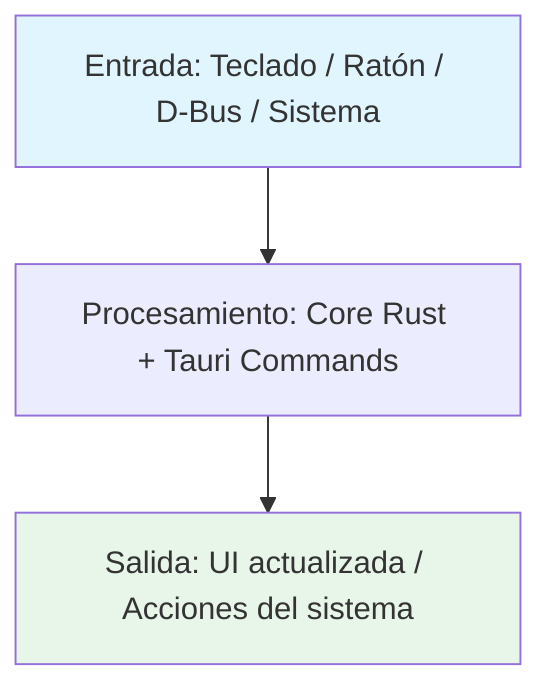
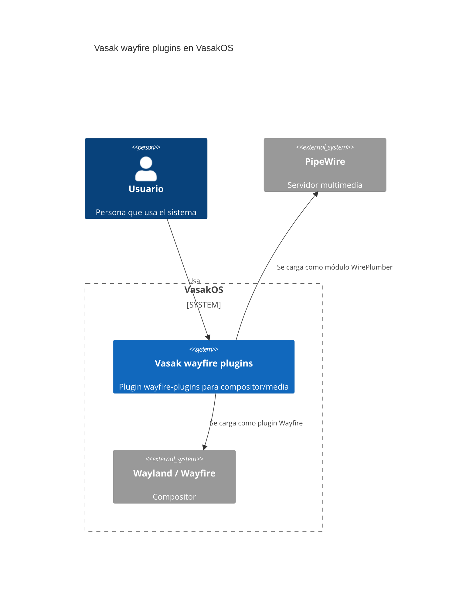

# Vasak wayfire plugins

Wayfire Plugin

---

## Tecnología

[](https://isocpp.org/) [](https://mesonbuild.com/) [](https://wayfire.org/) [](https://wayland.freedesktop.org/)

## Estado

[](https://github.com/Vasak-OS/vasak-wayfire-plugins/actions/workflows/ci.yml)
[](https://github.com/Vasak-OS/vasak-wayfire-plugins/releases)
[](LICENSE)
[](https://sonarcloud.io/summary/new_code?id=Vasak-OS_vasak-wayfire-plugins)
[](https://sonarcloud.io/summary/new_code?id=Vasak-OS_vasak-wayfire-plugins)
[](https://github.com/Vasak-OS/vasak-wayfire-plugins)

---

## Descripción

Wayfire Plugin

**Para el usuario:** Wayfire Plugin

**Integración VasakOS:** Integra con el ecosistema VasakOS vía D-Bus y configuración compartida.

---

## Arquitectura (diagramas)

> Copia y pega la plantilla que necesites, descomenta y adapta.

### Flujo de datos



### Componentes internos

```mermaid
flowchart LR
    subgraph App[Vasak wayfire plugins]
        UI[(sin frontend — plugin nativo)]
        Core[Plugin C/C++: lógica principal]
        IPC[API nativa (Wayfire / WirePlumber)]
    end
    UI --> IPC
    IPC --> Core
    Core --> DBus[(D-Bus / zbus)]
    Core --> System[Wayfire compositor / WirePlumber session]
    style UI fill:#f3e5f5
    style Core fill:#e3f2fd
    style DBus fill:#fff3e0
    style System fill:#fce4ec
```

### Integración en el sistema VasakOS



---

## Instalación

### Arch Linux (repo oficial)

```bash
pacman -S vasak-wayfire-plugins
```

### Desde fuente

```bash
git clone https://github.com/Vasak-OS/vasak-wayfire-plugins.git
cd vasak-wayfire-plugins

# Build con meson
meson setup builddir
meson compile -C builddir

# Instalar
sudo meson install -C builddir
```

---

## Uso rápido

```bash
# Se carga automáticamente por Wayfire / WirePlumber
# Configuración en:
# ~/.config/wayfire/ini  (Wayfire)
# ~/.config/wireplumber/  (WirePlumber)
```

### Atajos / flags principales

| Acción | Comando |\n|--------|---------|\n| Build | `meson compile -C builddir` |\n| Test | `meson test -C builddir` |\n| Install | `meson install -C builddir` |

> **Captura:** `assets/demo.gif` *(placeholder — sustituir por GIF real)*

---

## Configuración

### Configuración

**Wayfire:** `~/.config/wayfire/ini` o `/etc/xdg/wayfire/ini`
**WirePlumber:** `~/.config/wireplumber/main.lua.d/` o `/etc/wireplumber/main.lua.d/`

### Variables de entorno

| Variable | Descripción | Por defecto |
|----------|-------------|-------------|
| `MESON_DEBUG` | Activa logs de depuración de meson | `false` |
| `VASAK_PROFILE` | Perfil de rendimiento: balanced, performance, power-save | `balanced` |

### Integración con `tauri-plugin-config-manager`

(plugin nativo — sin integración config-manager)

---

## Desarrollo

### Requisitos

- **Rust:** `rustup` toolchain estable (`rust-toolchain.toml` fija la versión)
- **Node / bun:** `bun` ≥ 1.1 (nunca npm/yarn/pnpm para apps Tauri)
- **Sistema:** `pkg-config`, `libgtk-3-dev`, `libwebkit2gtk-4.1-dev`, `libssl-dev`
- *`meson`, `ninja`, `clang`, `wayfire-dev` / `wireplumber-dev`*

### Dependencias de desarrollo

#### Sistema (paquetes Arch / Debian / Fedora)

`base-devel`, `pkgconf`, `libssl-dev`, `libwebkit2gtk-4.1-dev`, `libgtk-3-dev`, `libayatana-appindicator3-dev`, `librsvg2-dev`, `gstreamer1.0-plugins-base`, `gstreamer1.0-plugins-good`, `libpipewire-0.3-dev`, `libwireplumber-0.5-dev`, `libdbus-1-dev`, `libudev-dev`, `libxkbcommon-dev`, `libwayland-dev`, `meson`, `ninja`, `clang`, `lld`

#### Rust

`rustup` → `stable` + `rustfmt` + `clippy`

#### Node

**Solo `bun`** (nunca npm/yarn/pnpm para apps Tauri). `bun --version` ≥ 1.1

#### Herramientas CLI

`just` (command runner), `cargo-binstall` (opcional), `cargo-llvm-cov` (para cobertura)

### Correr en desarrollo

```bash
# Build incremental
meson compile -C builddir

# Tests
meson test -C builddir
```

### Compilar / Build de release

```bash
# Build release
meson setup builddir --buildtype=release
meson compile -C builddir
meson install -C builddir
```

### Targets principales

```bash
# Desarrollo
meson compile -C builddir

# Build producción
meson setup builddir --buildtype=release && meson compile -C builddir

# Solo frontend
(no aplica — C/C++)

# Solo backend Rust
(no aplica — C/C++)

# Lint + tipos (pre-commit / CI)
clang-format --dry-run --Werror src/
```

### Pruebas

```bash
# Tests con meson
meson test -C builddir

# Scripts adicionales
./pruebas/run-all.sh
```

### Convención de commits

[Conventional Commits](https://www.conventionalcommits.org/es/v1.0.0/):

```
<tipo>(<ámbito>): <descripción corta>

[cuerpo opcional]

[pie opcional: Closes #N]
```

Tipos habituales: `feat`, `fix`, `bugfix`, `docs`, `ci`, `chore`, `security`, `refactor`, `perf`, `test`.

### Cómo abrir PR

1. Rama desde `origin/main`:
   ```bash
   git worktree add -b feat/{{TEMA}} ~/wt/vasak-wayfire-plugins-{{TEMA}} origin/main
   ```
2. Prefijos de rama: `fix/`, `feat/`, `bugfix/`, `docs/`, `ci/`, `chore/`, `security/`
3. Escribe el fix → **`qa` escribe las pruebas** (fallan sin el fix) → suite verde → abre PR
4. Al abrir PR, **cuatro cosas obligatorias**:
   - Asignado a `JoaquinDecima`
   - Etiqueta `enhancement` o `bug` (+ `ci` / `dependencies` si aplica)
   - Añadido al proyecto «VasakOS Roadmap»
   - Status **In Progress**

---

## Arquitectura (texto)

### Crates / módulos principales

| Módulo | Responsabilidad |\n|--------|-----------------|\n| `vasak-wayfire-plugins` | Plugin C/C++ para Wayfire / WirePlumber |

### Interfaces D-Bus / zbus expuestas

(no aplica — plugin nativo sin D-Bus directo)

### Puntos de extensión

- **Plugins:** Sistema de plugins modular
- **Hooks:** Hooks de ciclo de vida
- **API pública Rust:** API pública del crate principal

### Features / Cargo features

| Opción meson | Descripción | Default |\n|--------------|-------------|---------|\n| `tests` | Compilar y correr pruebas | true |\n| `docs` | Generar documentación Doxygen | false |


---

## Pruebas y calidad

- **Cobertura objetivo:** ≥ 80 % del código nuevo (SonarCloud Quality Gate)
- **Informes:** GitHub Actions → pestaña *SonarCloud Code Analysis* → enlace a SonarCloud
- **Añadir pruebas:** ver `AGENTS.md` sección 9 (mapa de repos y comandos de prueba)
- **Regla:** toda corrección lleva prueba escrita por `qa` que falla sin el fix

---

## Contribuir

- **Guía:** [`.github/CONTRIBUTING.md`](https://github.com/Vasak-OS/.github/blob/main/CONTRIBUTING.md)
- **Plantillas de issue:** [`.github/ISSUE_TEMPLATE/`](https://github.com/Vasak-OS/.github/tree/main/ISSUE_TEMPLATE)
- **Código de conducta:** [`CODE_OF_CONDUCT.md`](https://github.com/Vasak-OS/.github/blob/main/CODE_OF_CONDUCT.md)

---

## Contribuidores

> **Actualizado automáticamente en CI** — muestra los avatares de quienes han aportado código a este repo.

<div align="center">
  <a href="https://github.com/JoaquinDecima" target="_blank"></a>
</div>

[Ver todos los contribuidores](https://github.com/Vasak-OS/vasak-wayfire-plugins/graphs/contributors)

---

## Donadores / Sponsors

[](https://github.com/sponsors/Vasak-OS)

> **Backers:** *Actualizado automáticamente en CI desde GitHub Sponsors / OpenCollective / Polar.*

[💖 Donar al proyecto](https://github.com/sponsors/Vasak-OS)

---

## Licencia

`GPL-3.0` — Copyright © 2026 **Vasak-OS Contributors**

[Ver licencia completa](LICENSE)
